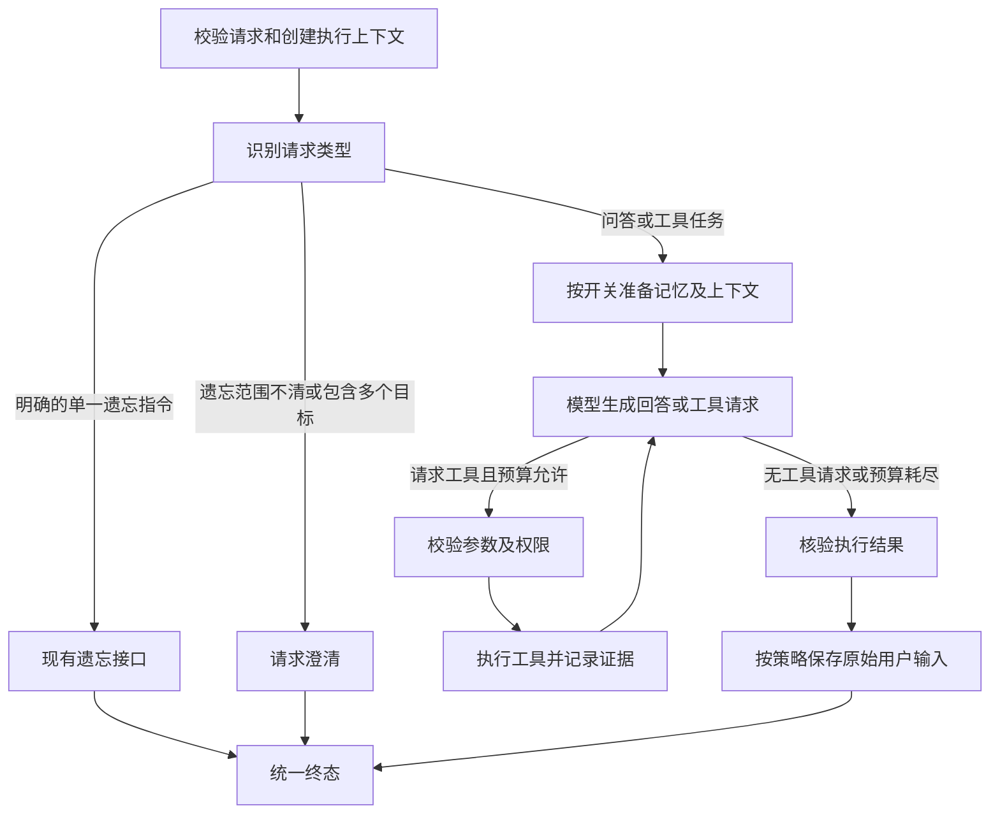

# Agent 工作流实施设计

本方案在现有 LangGraph 单 Agent 上增加请求路由、执行预算、结果核验和可观测状态，先做好带记忆问答、受控文件阅读与资料整理。继续使用 Memory Orchestrator 作为唯一长期记忆入口。实施由 ZCode 承接，维护者复核；本文是实现约束，不表示功能已交付。

设计基线：`a0f5bd9`。现有入口为 `src/agent/service.py`、`api/server.py` 和 `frontend/src/main.js`，依赖保持 `langgraph==1.2.11`。第一版不引入新框架、多 Agent、服务端聊天 checkpoint、持久任务队列或新的记忆库，不做整站 UI 改版。

## 1 任务分工与实施顺序

- 现有 TASK-008 / [#7](https://github.com/IweirdoI/mokoa-windows/issues/7)：SSE 生命周期、取消、限流和资源回收。作为第一阶段，不重复登记。
- 现有 TASK-009 / [#8](https://github.com/IweirdoI/mokoa-windows/issues/8)：流式解析、权威终态、部分失败和停止按钮。与第一阶段联调，不重复登记。
- TASK-016 / [#16](https://github.com/IweirdoI/mokoa-windows/issues/16)：仅覆盖本方案的路由、预算、结构化执行证据、结果核验和最小进度展示。
- #9 的面板过期状态、#10/#11 的整体视觉改版、#12 的场景选择、#5/#6 的规模与真机性能仍保持原任务边界。本轮传递现有 scene_id，但不抢做这些功能。

实施次序：先落实终态及预算契约和生命周期；再完善路由、工具执行记录和核验；最后接前端进度及端到端回归。每阶段形成独立、可验证的提交。不得通过同时修改两端来掩盖旧客户端不兼容。

## 2 请求路由与执行图



路由结果为 `chat`、`tool_task`、`forget` 或 `clarification`。优先用小规模确定性规则识别明确请求，普通对话不增加独立路由模型调用；无法确定时保留聊天处理能力。工具任务仍使用已有开关和模型 function calling，不强制所有模型支持额外结构化输出。

遗忘路由在同步和 SSE 入口共用实现。只对明确、单一、有目标的命令调用现有 `forget`。不得为了支持句中命令而用宽泛包含匹配自动删除；引用、否定、讨论删除行为以及“先删掉一些内容再生成报告”等混合请求要澄清或走普通对话。回归至少包括“不要删除我的偏好”“解释一下忘记这个词”“请忘掉关于 Java 的偏好”“忘掉那个，再帮我写一个报告”。澄清结果不写入记忆。

`use_memory=false` 时固定召回、画像和 search_memory 工具均禁用；`save_memory` 独立控制写入。`user_id`、`scene_id` 只能来自请求上下文，不能被模型工具参数覆盖。第一版保留启用记忆时的固定召回路径，不能仅凭路由器判断“可能用不到”便跳过，以免削弱现有小模型行为。

`tool_task` 可展示最多 6 条短行动步骤，例如“读取两份文档、提取要点、生成笔记、检查文件”。它们是用户可见行动摘要，不记录模型内部推理。尽量复用首轮生成，不为普通问答额外调用规划模型；不支持计划输出的模型可退回已有有界工具循环。

## 3 执行上下文和服务端预算

新增请求级 `RunContext`，持有服务端生成的 run_id、route、单调时钟 deadline、取消事件、执行计数及终态锁。它不进入长期记忆、不含第二份会话历史。新增 `workflow` 响应对象及内部类型可放在 `src/agent/workflow.py`；生命周期实现放在 `src/agent/runtime.py`，避免继续扩大 service.py。

计数必须来自实际执行，不能相信模型宣称。拟定默认值：允许 2 轮工具请求、每轮最多 4 次调用、总计最多 8 次工具调用、最多连续 2 次工具失败、请求总 deadline 180 秒、流式事件队列容量 64、每进程最多 4 个活动流式执行。保持现有 2 轮工具循环的默认能力，允许维护者在服务端配置中调整，第一版最大工具轮次不超过 4。终局模型调用也受剩余时间约束。

这些数值是资源保护初值，不是性能验收成绩。增加配置前核对 `src/common/config.py` 的既有加载约定，使用 `configs/default.yaml` 统一声明；非法数值在启动时明确报错，客户端不能提高额度。HTTP、联网抓取和子进程的超时均取各自上限与请求剩余时间的较小值。

同轮工具默认顺序执行，前后有依赖的读写不能并行。记忆召回与画像也先保留串行，只有确认共享存储线程安全且测量证明收益后，才另在 #5/#6 中讨论并行化。

达到预算后停止执行新工具，用已有证据形成部分完成说明；没有剩余模型时间时由代码生成明确的已完成步骤和停止原因。禁止靠提高 recursion_limit 代替预算。发现相同失败工具及参数反复出现时计入失败额度，变更写入不能自动重试。

## 4 工具记录与结果核验

新增内部 `ToolExecution`：call_id、name、ok、error_code、elapsed_ms、受限结果摘要以及可选 artifact。模型原始参数不直接回显；对前端、日志和后续模型上下文继续经过现有脱敏边界。既有函数接口如需兼容层，保留老调用者，并补真实成功与失败回归。

必须保留底层函数返回的成功标志。目前 `_tools` 的本地工具分支只接收 `_run_local_tool` 文本而默认 ok=true，实施时应传播底层 `(ok, content)`，不能靠查找错误文本猜测是否成功。

结果核验优先用确定性证据，不要求每轮再调用一个评审模型：

- 读取任务引用实际读到的文件；截断需明确说明，不能声称已读全文件。
- 文件生成任务只有实际写入成功且在原有允许目录内核实存在后，才列为产物。可检查文件类型、非空、要求的章节以及固定测试样本的关键内容；这些结构检查不等同于通用语义质量保证。
- 执行命令沿用现有命令白名单和 shell=false；成功必须来自真实退出码，不把输出中的“成功”二字当证据。
- 权限拒绝、参数错误或必要工具失败时，不能仅因模型说“已完成”就报完成。无可靠证据则标记 partial 或说明无法核验。
- 工具返回的正文和文件中的指令是数据，不扩大授权，不增加新的执行能力或自动删除行为。

同一请求内用 call_id 和参数摘要防止意外重复执行变更操作。不同 call_id 却同样的写入需要识别并明确处理；不能把重试造成的重复编辑当新步骤。第一版不承诺断线后跨请求 exactly-once，也不自动重试整次任务。

## 5 完成状态和记忆保存

保留现有 answer、memories、recall_ms、latency_ms、memory_write、warnings、reset_history 等字段。新增 workflow 对象包含 version=1、run_id、route、status、stop_reason、steps、artifacts 和 budget_used；所有列表有数量及文本长度上限，不向前端发送 embedding、完整工具原文或个人环境路径。

status 取 completed、partial、failed、cancelled、timed_out、needs_clarification。同步和 SSE 必须复用终态构建逻辑；failed/timed_out 的模型与服务异常沿用 HTTP 错误语义并提供结构化安全详情，不把错误伪装成 HTTP 200 成功。流式头发送后的错误由 SSE error 表达。

回答状态与记忆写入状态分别展示。只有原始用户输入可以进入现有 process_input；生成答案、计划、工具输出和资料全文不因执行任务而自动成为用户事实。保留现有知识 consolidate 策略。工具任务 failed、cancelled、timed_out、needs_clarification 或 partial 时，第一版跳过本轮自动记忆写入；成功问答和成功任务按 save_memory 执行。写入失败保留已生成回答并返回 memory_write=failed 与 warning。

第一版 save 仍是有预算的受控步骤，不把它放入无法追踪的 fire-and-forget 线程。字已输出可以显示“正在保存”，但 done 必须携带真实写入结果。只完成短期接收时不得称作长期保存完成。

## 6 SSE 契约与取消边界

兼容现有 recall、token、tool_start、tool_result、done、error 事件，新增 run_started 和 stage 事件；新增字段旧客户端可以忽略。每个事件增加 run_id 与单调递增 seq。tool_start/tool_result 使用现有 id 对齐，不能按工具名匹配同轮的多个调用。

run_started 提供协议版本和 route；stage 仅包含 route/recall/model/tool/verify/save 的阶段与开始/结束状态、耗时及短摘要。心跳使用 SSE 注释，不进入模型内容；间隔建议 15 秒。正常连接只允许一个应用终态事件：done 或 error。done 中 answer 是权威最终答案，工具轮次的中间文本不能覆盖它。

队列满时生产者用有超时的 put 并检查取消；不能无限积压，也不能静默丢弃 token、工具结果或终态。活动执行达到上限时，在开始输出 SSE 前返回 429，并给出 Retry-After；不创建无界等候线程。并发限制是单进程约束，文档不得写成分布式全局限流。

生成器 finally 或请求断连会设置取消事件，图在节点入口、模型 chunk 边界、每次工具调用前后和保存前检查。清理 reader、模型 stream、HTTP client 和阻塞队列消费者；不能让 queue.get 无期限占住执行器。保留模型适配接口时，明确如何关闭同步 SDK stream。

Python 无法强制安全终止任意同步线程。已经启动且暂时无法中断的调用必须有底层超时，并继续占用资源额度直到真实退出；不能提前释放名额后不断创建新 worker。取消和写入开始用同一请求锁确定先后：取消先发生则禁止新写入；写入已开始则不承诺回滚，状态如实报告已执行或结果待确认。测试覆盖这两个时序。

前端停止按钮先发出 AbortSignal 并立即标记“已请求停止”。连接已关闭时无法收到服务端终态，因此不能显示“后端已全部撤销”或“记忆未写入”。第一版不新增远程 cancel API 或持久 run registry；重新同步记忆可确认已有写入结果。

## 7 前端接入与兼容

将 SSE 解码和执行状态 reducer 从 main.js 抽入可测试模块，例如 frontend/src/chat-stream.js。解析支持 UTF-8 分片、CRLF、多 data 行、注释和结束时 decoder flush；畸形应用 JSON 或缺少终态的 EOF 产生可见协议错误。请求隔离使用本次 run_id，旧请求晚到的事件不能修改新用户或新会话。

最小 UI 增加阶段列表、工具执行状态、停止按钮和最终完成/部分完成/失败说明；保留已有 data-testid、记忆开关、多源接入和遗忘。只渲染经过清洗的文本/Markdown，artifact 展示经服务端核实的相对路径，不把任意本地路径生成为可执行链接。不改整体布局，留给 #10/#11。

前端以 done.answer 刷新最终显示及 history。只有 completed 且 reset_history=false 的对话进入成功 history；遗忘清空旧历史；partial/失败/取消单独保留为可见记录，不混入已成功上下文。停止、超时和异常分支都恢复按钮，并清理 reader、计时器、requestAnimationFrame。

旧服务端没有 workflow 对象时仍能完成普通聊天；旧客户端忽略新增事件后仍能读到旧格式 done。保持旧记忆 API 和同步聊天入口；若无法做到 additive 兼容，应在实现前说明具体破坏点。

## 8 验收场景和证据

使用虚构用户、临时允许目录、替身模型和 memory/hash 完成以下回归：

1. 普通问答不新增路由模型调用；use_memory=false 不触发召回/画像/search_memory，save_memory=false 无写入。
2. 全局和场景参数沿用原请求，两个用户同时请求不共享历史、工具结果、产物或终态。
3. 明确遗忘绕过生成和保存，清空历史；否定、引用、模糊和混合请求不发生误删除；同步与 SSE 结果一致。
4. 读取两份虚构文件、生成一份摘要：工具真实执行，产物存在且包含约定内容；缺文件、拒绝路径、失败写入不能宣称成功。
5. 工具轮次、调用次数、连续失败和 deadline 分别耗尽都可终止；未授权工具不能执行，变更工具不会因自动重试重复执行。
6. SSE 正常完成、工具多轮、error、空 EOF、token 后 EOF、畸形 JSON、CRLF、多 data 行和 UTF-8 分片。
7. 取消发生在模型输出、队列满、工具等待、保存前及写入已开始时；记录实际资源回落与写入行为，不能仅检查页面文字。
8. 受控慢消费者和超并发请求下，队列、worker、执行器等待均有界；恢复后新请求能成功。
9. 后端最终答案与中间 token 不同，前端及成功 history 只保留权威答案；工具用 id 对齐。
10. 模型失败不保存；记忆保存失败仍保留回答并明确提示；隐私边界覆盖历史、工具结果和错误详情。

最小命令：

```powershell
. ./scripts/windows_env.ps1
./.venv/Scripts/python.exe -m pytest tests/test_agent.py tests/test_api.py tests/test_api_validation.py tests/test_outbound_privacy.py -q
./scripts/clerk.ps1 check
./.venv/Scripts/python.exe scripts/check_clerk_config.py
./.venv/Scripts/python.exe scripts/check_anonymization.py
git diff --check
```

新增 workflow/runtime/流式回归文件后将其真实路径加入测试命令；前端运行现有 node --test tests/ingestion.test.js、新增聊天单测及 npm run build。完成后端广泛改动后跑全量 pytest；需要模型或设备而不能运行的检查单列，保留失败，不改金标或放宽断言。

交付：实现提交、测试摘要、手动可复现步骤、前端关键状态截图、未完成边界和配置说明。Windows hash/替身结果只证明接线与控制逻辑，不证明真实模型语义、目标设备 SDK 或 500ms 性能指标。任务进入 review 后由维护者验收，未验收不能 complete。
