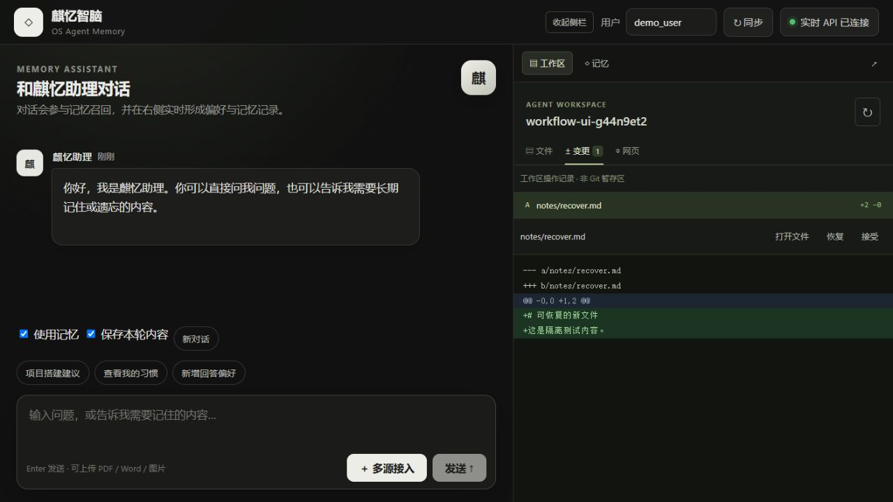
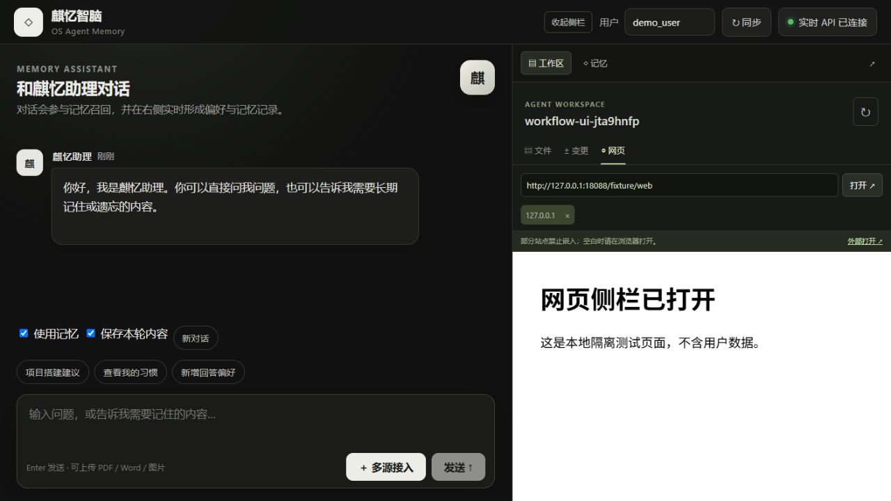
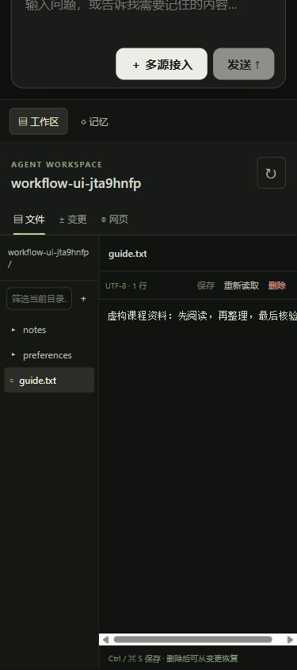

# Agent 文件与网页工作区

TASK-017 / [Issue #19](https://github.com/IweirdoI/mokoa-windows/issues/19)。
侧栏新增“工作区 / 记忆”切换；现有记忆摄取、查询和遗忘仍走原接口。
实现为 `src/agent/workspace.py`、`api/workspace.py`、`frontend/src/WorkspacePanel.js`。
没有新依赖，也没有修改 MemoryEntry 或记忆存储 Schema。

## 启用

在启动 API 的终端配置你信任的本地目录，再按 [接入说明](LANGGRAPH_AGENT.md) 启动服务：

```powershell
$env:AGENT_EXEC_CWD = 'E:\your-project'
$env:AGENT_ENABLE_WORKSPACE = '1'
# 只有模型支持 function calling 时才启用模型文件工具：
$env:AGENT_ENABLE_TOOLS = '1'
```

`AGENT_ENABLE_WORKSPACE` 控制侧栏的 HTTP 文件接口；未设置时沿用
`AGENT_ENABLE_TOOLS`。`.env.example` 显式设为 0，新环境需改为 1。
设置为 1 不会自动开放模型工具、终端命令或后端网页抓取。
`AGENT_EXEC_CWD` 未设置时仍沿用进程工作目录。
网页标签可独立使用，不需要模型或文件权限。

这是主机共享的本地工作区，沿用现有 `API_AUTH_TOKEN` / `VITE_API_TOKEN`
鉴权；`user_id` 不提供文件隔离。远程部署应配置鉴权并限制服务访问者，
不要把任意用户输入当作工作区根目录。这不是操作系统沙箱，不能隔离同一主机上的恶意进程。

动作目录的 `POST /workspace/actions/{name}` 必须配置 `API_AUTH_TOKEN` 并发送
`Authorization: Bearer <token>`。动作源于服务端选定的工作区，只开放只读工具。

设置 `AGENT_REQUIRE_FILE_CONFIRM=1` 后，Agent 发起的文件写入、编辑和删除会在流式对话中请求确认。
在确认卡用 Tab 切换操作、Enter 或空格提交，焦点在卡片上时可用 Esc 拒绝。
批准只适用于卡片显示的目标及其当时版本。同步聊天没有确认通道，启用此设置时会拒绝文件变更。

## 界面与操作

- 文件：逐级目录浏览、面包屑返回、当前目录筛选与分页；UTF-8 文本预览、新建、编辑、保存和删除。
  Ctrl / Command S 保存；切换文件或离开页面时提示未保存草稿。
- 变更：展示你和 Agent 通过文件工具产生的累计变更、增加/删除行数和统一差异。
  差异以该文件首次受控修改前为基线；已删除文件展示删除前的内容。
  这些记录不是 Git 工作树、暂存区或聊天轮次快照。
- 删除后的“恢复”取回删除前最后内容，包括新建文件与空文件；此前已有累计修改的，
  恢复删除后仍保留变更记录。对存在文件执行“恢复”则撤销累计修改，回到首次修改前；
  新增文件回到不存在的状态。
- “接受”保留当前磁盘内容并清除此文件的恢复记录，界面会确认；不会执行 Git commit。
- 保存、删除、恢复与接受都携带原文件 SHA-256 版本；过期请求返回 409，
  不自动覆盖他人修改。外部变化会标记冲突，并禁止自动恢复；先打开文件比较再处理。
- 聊天中的实际工具路径、核实产物及相对 Markdown 文件链接可以打开工作区；
  删除产物直接进入相应差异。工具完成、终态和手动刷新会更新目录/变更列表，
  不自动覆盖编辑器中的草稿。
- 网页：HTTP(S) 地址、最多 8 个标签和外部浏览器入口。回答中的普通网页链接在侧栏打开，
  Ctrl / Command 点击仍遵循浏览器默认行为。页面在受限 iframe 内运行，
  不赋予同源访问、父页面导航或主应用的 API Bearer 凭据。
  站点 CSP / X-Frame-Options、HTTPS 混合内容及登录限制可能阻止呈现，使用“外部打开”。
  这不等于 Chromium 桌面浏览器或网页自动操作工具，也不会代理绕过站点嵌入策略。

## 文件与恢复记录边界

仅支持不超过 64 KiB 的 UTF-8 普通文本；不删除目录，不跟随符号链接、Windows
目录联接或硬链接。拒绝 `..`、目录外路径、NTFS ADS、保留设备名，以及
`.env`（除 `.env.example`）、私钥、数据库、`.git`、`.clerk`、依赖目录和工作区内部记录。
文件工具的读取、搜索、写入、编辑和新增 `delete_file` 共用这些限制。
文件删除与“忘掉偏好”等记忆遗忘分别路由，不互相替代。

恢复数据在根目录 `.mokoa-workspace/changes.sqlite3`，不进入用户记忆。
记录原始字节、最后版本、文件 mode 和删除前内容；API / Agent 先持久化恢复数据，
再原子替换文本或删除文件。独立 SQLite 写锁串行化多个服务实例的写入。
这不能阻止其他编辑器在版本检查后直接修改文件或改变目录结构，
不要让不可信进程同时操纵工作区；版本校验不构成完整的 OS 文件事务。
异常中断可能留下冲突记录，应比较磁盘现状，不能声称操作已回滚。

最多保留 200 个未接受的文件记录；达到上限拒绝新增文件变更，不自动清除恢复数据。
删除 `.mokoa-workspace` 会失去恢复能力；不要提交、分发其中的文件或数据库备份。
文件内容外发给模型仍经过现有出站隐私处理；侧栏文件内容只由本地文件 API 返回，
网页 iframe 不会接收文件内容。

## 验证

```powershell
. ./scripts/windows_env.ps1
./.venv/Scripts/python.exe -m pytest tests/test_workspace.py tests/test_agent.py tests/test_agent_workflow.py -q
cd frontend
node --test tests/workspace.test.js tests/chat-stream.test.js tests/ingestion.test.js
npm run build
```

`tests/test_workspace.py` 使用隔离临时文件和真实 SQLite，覆盖持久恢复、空文件/新文件删除、
UTF-8 字节限制、链接逃逸、敏感路径、目录分页、外部冲突、两个独立服务实例并发、
恢复记录上限、换行差异与 API 契约。Agent 回归覆盖文件删除不会触发记忆遗忘及核实产物。

手动页面夹具：根目录运行 `frontend/tests/serve_workflow_api.py`，前端设置
`VITE_API_TARGET=http://127.0.0.1:18088`。脚本打印隔离目录，提供虚构文本、
“读取”“删除”“失败”“慢速”工具场景和 `http://127.0.0.1:18088/fixture/web` 网页。
测试的是 Windows、memory/hash、替身模型和真实 FastAPI/LangGraph 接线；
不证明真实模型的操作判断质量、语义检索性能或麒麟 SDK 验收。

## 本轮验证记录

2026-11-22，Windows / Python 3.12：完整后端回归 826 passed、6 skipped；
随后完善删除文件差异展示，工作区与 Agent 相关 105 项再次通过。
前端 24 项 Node 测试与生产 build 通过；Clerk、配置、匿名化和差异格式检查通过。
6 项跳过为缺少 sentence-transformers、缺少偏好 LLM 密钥、3 项未分发真实语料、
Windows 文件权限用例；本轮未新增跳过或更改金标。

使用 computer-use 在隔离目录实测新建、编辑保存、删除、恢复新文件、差异查看、
聊天文件/网页链接与 Agent 删除工具、网页标签/本地嵌入、390px 手机布局。
真实模型与麒麟设备未运行。本轮由 Codex 按用户需求实现，保留原有模块来源。






