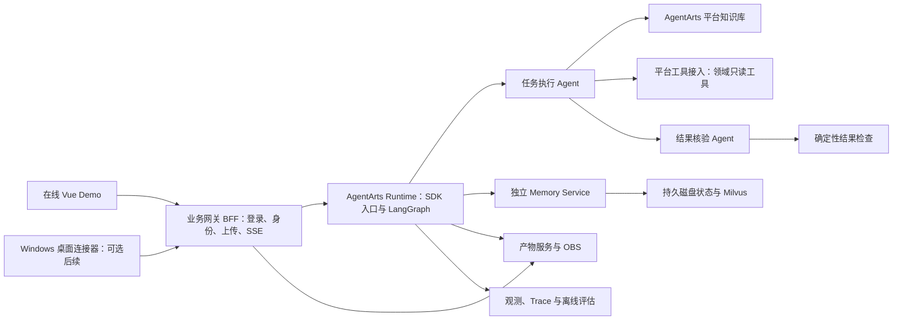

# AgentArts 参赛适配实施方案

<!-- clerk:meta
id = DOC-001
slug = agentarts-adaptation
title = AgentArts 参赛适配实施方案
revision = 0.1
implementation = planned-not-deployed
task = TASK-040
updated = 20261124-001512
-->

## 适用范围与状态

方案日期：2026-11-23。代码核对基线：`963e78cb4ac6e249a83e178d373f5512f00be1b7`。登记任务：[TASK-040 / Issue #51](https://github.com/IweirdoI/mokoa-windows/issues/51)。

本文件交付参赛适配设计，不代表已经接入、部署或通过组委会验收。当前核对环境为 Windows 本地仓库；本轮只做代码阅读、官方资料核对及文档管理验证。AgentArts 账号、区域、配额、真实模型、ARM64 镜像和云上运行均待实施阶段核验。此前讨论的电子实训、无障碍课件等均未正式定题，本设计不默认选中其中一个。

采用的主路线是：保留自研业务与 LangGraph，增加 AgentArts Runtime 入口，以代码形式完成编排；接入平台知识、工具及评估能力，部署可在线交互的 Demo。偏好记忆作为按需启用的增强功能，不作为平台适配或作品创新性的唯一论据。

本次新增设计由 Linnea 授权 Codex 辅助整理，原项目、Windows 工程化及第三方成果的归属保持可追溯，见[发布说明](../发布说明.md)和[贡献指南](../../CONTRIBUTING.md)。不复制华为 SDK 源码或官方教程全文，外部能力以参考资料及实际实施版本为准。

## 赛题要求与证据

需求依据为用户提供的官网文字及截图，官网入口见参考资料 R1。本文据此设计技术覆盖，不能代替组委会对高代码路线的书面确认。

1. **基于 AgentArts 构建、编排与部署。** 在仓库中保存 Runtime 适配入口和版本化的 LangGraph 编排，通过官方 SDK 构建 ARM64 镜像、部署运行时。留存源码提交、SDK 版本、镜像摘要、运行时版本、访问方式及真实调用记录。只换 MaaS 模型或只部署普通 ECS 不满足本设计的交付门槛。
2. **可视化 Demo 展示核心功能及交互。** 保留 Vue 工作台，新增云端运行标识、执行阶段、知识依据、工具结果、核验结果与产物入口。交付可在线访问的受控演示入口、使用说明、演示录像和冷启动复现记录。
3. **体现智能体设计、工具编排、知识接入、多 Agent 协作与效果评估的使用价值。** 实现有边界的业务执行角色和核验角色，通过平台可接入工具及平台知识库完成至少一条真实任务链，在 AgentArts 发起评估。保存角色输入输出边界、调用链、知识库版本、工具配置和逐样例结果。现有路由节点、普通函数或只读检查函数不冒充多个 Agent。
4. **完整开发闭环。** 保存场景访谈与需求、设计版本、知识与工具构建、失败样例、优化前后对照、发布版本及线上反馈，串起需求—编排—调试—评估—部署。
5. **决赛材料与分享。** 准备设计说明、在线 Demo、知识库/语料方法、自定义工具说明及分享材料；全球赛阶段另外记录真实应用进展和社区反馈。只登记本任务实际完成的文档，不提前填写上线、用户数、效果或分享数据。

代码开发与 Runtime 是官方支持的产品路径（R2、R3），但产品支持不等于赛事已批准“纯托管即可”。本设计在托管之外增加知识、工具、角色协作与平台评估的实质接线，并设立赛方口径确认门槛。

## 现状与适配缺口

代码事实来自本轮阅读，不把历史文档的目标数字当作成绩。

- `src/agent/service.py` 已有 `MemoryAgent`、有界工具循环、记忆调用和流式输出；`src/agent/workflow.py`、`runtime.py` 提供路由、预算与执行状态。详见[工作流设计](../AGENT_WORKFLOW.md)。尚无 AgentArts 入口与云端调用适配。
- `api/server.py` 提供同步聊天、SSE、记忆和会话接口。已有可选 `API_AUTH_TOKEN`；共享令牌只能证明调用方持有令牌，不能作为多用户数据隔离的身份依据。云端必须增加服务端身份映射。
- `ChatRequest` 包含 `user_id`、`scene_id`、记忆开关及可选 `session_id`。当前 API 已出现会话接线，但 TASK-018 仍在进行中；本方案不据此认定其全部验收完成，也不抢改相关工作。
- Agent 调用记忆的主要方法为 `recall`、`get_preference_profile`、`process_input`、`consolidate`、`forget`。现有摄取、偏好和存储继续通过 Memory Orchestrator，云适配不得另建第二套个人记忆。
- 本地工具使用宿主路径、精确许可命令和工作区文件；进入云端后，其宿主变为云运行环境，不能直接解释 Windows 的盘符或假设能访问用户桌面。详见[文件工作区](../AGENT_WORKSPACE.md)。
- `configs/default.yaml` 的摄取 SQLite、偏好版本文件等有本地状态；`memory` 后端是开发内存存储。不能将它们原样放进临时 Runtime 磁盘并声称持久化。
- `src/security/outbound.py` 已有出站文本处理与外部 URL 限制。新 Runtime 入口、平台知识查询、工具参数、工具输出及 Trace 是新的数据边界，需逐项接线；原模型客户端的处理不会自动覆盖它们。

现有任务 TASK-007、TASK-018、TASK-020、TASK-021/022、TASK-034/037 保持原负责人、验收范围和状态，本设计仅声明对接依赖。

## 目标架构与职责

**Vue Demo / BFF。** 前端调用同源业务网关，由网关持有云服务凭据。浏览器不直接持有 Runtime、MaaS、OBS 或工具服务密钥。公开演示默认只访问虚构项目数据及隔离产物，不提供维护者桌面或私有仓库入口。

**Runtime。** 承载实际推理、编排和角色协作；SDK 负责平台协议适配，业务角色和状态由版本化代码定义。云端请求失败明确结束，不静默改由本地 LangGraph 或其他云模型执行。

**Memory Service。** 第一阶段部署在华为云 ECS 的独立服务进程，使用持久磁盘和可验收的 Milvus 后端；偏好索引、脱敏索引、摄取状态及会话存储逐项列出实际路径、备份和恢复方式。先单实例，避免未解决的 SQLite/JSON 并发写被弹性扩容放大。内存中的短中期状态是否需要跨重启恢复必须逐项验收；挂载磁盘并不会自动持久化这些状态。若需改存储模型，另开实现任务。

**平台知识与自研记忆。** 平台知识库保存有授权的公共领域资料和规范；自研服务保存按用户隔离的个人记忆及偏好。两者按来源返回证据，不双写同一份个人画像。知识库版本、上传来源、切分方法、检索配置及失效处理均纳入发布记录。

**工具服务。** 第一个平台工具采用只读、可验证的领域查询或计算服务，按已选场景确定；在 AgentArts 的工具接入能力中登记、调试并留下调用证据。自定义 MCP 为可选实现方式，HTTP 工具插件同样可选；SDK 和参数以实施时官方文档为准。

**Windows 连接器。** 云端不直连用户 `localhost`，不公开任意 Shell 或文件接口。确需桌面任务时，由已配对连接器出站领取有租户、设备、期限和唯一 ID 的动作，按本机白名单、用户确认与目录边界执行，并回传结构化结果。接线依赖 TASK-020/021/022/034/037；没有连接器的云 Demo 仅操作云端演示工作区，并明确标识。

## 入口、接口与执行契约

下列是拟新增的项目接口设计，不是声称 SDK 已提供同名功能。实际平台端点及鉴权格式从本账号部署结果取得。

### 运行模式

拟新增 `AGENT_EXECUTION_PROFILE=local|agentarts`：`local` 保持本地开发；`agentarts` 的聊天必须经过真实 Runtime。启动时校验所需配置，缺少凭据或 Runtime 地址则拒绝启动该模式。不得以本地回答冒充云执行。

保留 `POST /agent/chat` 与 `/agent/chat/stream` 的业务入口。新增云提供者适配同步返回和事件；原有前端字段由网关做兼容映射。平台 `/invocations` 不直接替换前端 API；现有 SSE 也不能直接假定兼容平台流式协议。

### 身份与请求

- 网关通过登录会话派生租户和用户身份，覆盖或拒绝客户端伪造的 `user_id`；`session_id`、知识库、工作区和产物每次校验归属。
- 网关到 Runtime、Runtime 到 Memory/工具分别鉴权，使用有期限且限制受众的调用身份。外部工具参数不接受模型任意指定用户、服务地址或宿主路径。
- 只发送预算内、已处理的文本、授权附件引用、场景配置和必要历史。云端不能使用本地 LM Studio 回环地址；聊天、偏好提取、视觉与语义脱敏的模型配置逐项区分云端和本地。
- `use_memory` 与 `save_memory` 保持独立；关闭记忆不能通过工具重新召回。写入失败与回答状态分开显示。

### 运行与事件

- 网关生成 `request_id`，应用生成 `run_id`，平台返回 Trace 标识后记录关联；三者不强行合并为一个值。计划、模型、知识、工具、核验和终态均关联运行记录。
- 应用事件拟统一为 `run_started/stage/tool_start/tool_result/artifact/done/error`，每条带 `run_id` 和单调 `seq`。适配现有事件字段，终态唯一；只有实际结果才能标注完成。
- P1 先完成同步真实云调用。P2 单独验证平台流式协议、代理缓冲、超时及断连；通过后转换到既有 SSE。若只支持同步，界面显示等待并明确其限制，不用假 token 模拟流式验收。
- 用户停止先显示已请求停止。取消信号须传递至 Runtime 和工具；暂不能中止的已开始动作继续记录其结果，不宣称已经回滚。写操作有唯一动作 ID、幂等键及确认凭据，超时后先查询状态，禁止盲目重试。
- 超时、工具失败、无依据或知识缺失分别标注 `failed/partial/needs_clarification` 等业务状态。HTTP 成功不等于任务成功；核验条件未通过时不保存为成功经验。

### 记忆与产物

新增窄接口 `RemoteMemoryFacade`，仅适配当前 Agent 实际需要的五类方法；返回值恢复为现有模型类型。新增内部 ingest-and-consolidate 事务或有幂等状态的操作，避免摄取成功、晋升超时后重复写入；现有公开摄取端点不直接当作可无条件重试的 RPC。

记忆服务对全部请求校验调用身份及用户归属；API_AUTH_TOKEN 只能作为服务级凭据的一层，不代替用户授权。遗忘必须同步处理已覆盖的记忆索引和会话引用，并返回缺失或失败范围；平台 Trace、日志、OBS、备份等保留策略另列清单，不承诺自动全链路擦除。

产物使用 `artifact_id`、归属、版本和内容摘要引用，由产物服务授权下载。Runtime 临时工作目录按运行隔离；输入和输出明确上传/下载步骤，不把路径字符串当作已生成的文件证据。不将 OBS 当作 SQLite 数据库或并发文件系统。

## 角色协作、知识与评估

第一版拟设两个有独立输入、输出和工具范围的角色，由 LangGraph 调度并在 Runtime 实际运行：

1. 执行角色：理解任务、查询知识、发起有界工具请求，输出候选结果、来源和待核验事项。
2. 核验角色：独立调用模型检查证据是否支持候选结果，可调用只读核验工具，输出结构化结论和需要补做的动作。核验角色不具有文件写入、删除或外部提交权限。

文件存在性、金额计算、测试退出码、版本摘要等由确定性程序检查，不由核验模型自说自话。有限重试受总预算约束。仅在真实实现并测出作用后将其称为多 Agent；若单角色对照效果更好则如实报告，并调整协作设计，不保留装饰性调用。

AgentArts 平台知识库至少接入一份有版本的授权领域资料；建立包括命中、未命中、过期和冲突在内的测试样例。设计工具 schema、鉴权、超时和错误返回；在控制台完成独立调试，再由运行时角色调用，Trace 中能对应实际工具请求。

平台发起离线评估，同时以程序检查业务结果。比较同模型同资料、同等工具和预算条件下的通用助手基线、单角色流程和完整方案；记忆开关另做消融，不将记忆改善混同为角色协作改善。固定样本及金标，保留失败、重试、超时和费用；模型评估分不等于程序验收或用户任务成功率。

## 实施步骤

以下 P0—P5 为本设计的工作包，**尚未登记为新的 Clerk 实施任务，也未认领或完成**；开工时按实际边界登记并引用本文，不重复已有任务。负责人按模块建议，实际成员和工期由团队确认。

### P0：定题、平台探针与接入决策

- 与真实用户选定一个具体业务任务，确定输入、产物和成败条件。先用虚构文件整理任务验证云链路；该样例不能代替参赛场景创新。
- 向组委会确认高代码 LangGraph + Runtime 路线、平台能力使用证据及阶段部署要求；保存实际回复，未收到前只记为待确认。
- 在目标账号核对区域、开通权限、模型 function calling、知识库/工具接入、评估及配额；通过官方最小模板完成一次真实请求。
- 锁定实际验证的 SDK 与依赖版本、运行时协议、超时、流式能力及计费边界。失败则记录真实报错和可行替代设计，不直接改成无平台路径。
- 交付：场景一页说明、平台能力清单、一次调用与日志关联证据、部署决策。此阶段通过后才承诺云端实现排期。

### P1：Runtime 与网关同步闭环

- 拟新增 `src/integrations/agentarts/`，分别放 SDK 入口、平台客户端、事件适配、远程记忆外观；新增 `deploy/agentarts/` 保存镜像、独立云依赖清单、配置样例和操作说明。
- 在 `src/agent/service.py` 为模型、记忆和工具执行器提供可注入边界，隔离当前绑定宿主机的实现。修改公共调用契约前说明影响并补回归，不复制整套 Agent。
- 网关加入提供者选择与身份映射；Runtime 入口复用业务编排。先保证禁用写工具、隔离云工作区的同步成功/失败路径。
- 保留本地依赖清单，云 SDK 放独立依赖档，先检查 Python、LangGraph 及 ARM64 原生包兼容性，不给整个 Windows 环境直接升级 SDK 依赖。
- 验收：本地适配契约测试和 ARM64 Runtime 真实同步请求通过；云故障明确失败；现有本地聊天与记忆开关不退化。

### P2：状态、身份与流式兼容

- 在持久服务上验证记忆、索引和会话恢复，核对 TASK-007/018 的实际结果；云上下文不得依赖 Runtime 临时盘。
- 验证两用户、两运行的隔离，以及伪造 user/session/artifact、遗忘和失效凭据场景。
- 实现并验收流式协议转换、提前 EOF、终态去重、停止和超时；没有平台流式证据前不宣称已支持。
- 对照 TASK-020/022 的写入确认与动作幂等进展，未完成时云 Demo 保持只读或只写隔离产物。

### P3：平台能力与业务流程

- 实现平台知识查询和一个真实工具接入；由 P0 选定的业务决定工具，而非为了展示硬加无关 MCP。
- 接入执行/核验角色与程序检查器；收集一个成功、一个缺资料、一个工具失败、一个需要用户确认的完整运行。
- UI 标明云执行、知识依据、工具状态和核验结果；运行模式不能由模型文本伪造。秘密、原始隐私和模型内部推理不进入展示面板。

### P4：部署、观测与评估

- 由官方 SDK 初始化独立部署目录后，将已审查的适配代码放入入口；保存版本与镜像摘要。按 R4/R5 的当前要求使用 ARM64 构建环境，不把 Windows x86 构建结果当云上验收。
- 配置平台实际鉴权和网关访问方式；网关、记忆、工具和产物服务分别配置权限与网络。不得为接入关闭既有出站安全限制；可信内部服务使用独立客户端和固定配置，并单独防止任意地址访问。
- 在平台完成真实调用观测与离线评估，保存脱敏后的报告摘要和复现说明；不提交访问密钥或受限账号信息。
- 依次验证容器重建、Runtime 实例释放后重新调用、网关重启及记忆服务重启，确认已声明的状态保留范围。
- SDK CLI 的 `agentarts init`、`config`、`launch`、`invoke` 使用实施时 `--help` 及官方模板生成的参数；本文没有执行这些命令，也不提供凭空拼出的部署 ID 或配置。

### P5：验收、发布与回退

- 指定一个已评估的 Runtime 版本供 Demo 调用；发布前导出配置清单、数据版本和恢复步骤。演示账号分权限且限额，避免直接公开维护者服务。
- 回退切回上一已验证 Runtime 版本，并同步对应工具、知识和数据契约；只接受向后兼容数据变更，不用应用回退掩盖存储不兼容。
- 云服务不可用时保留失败提示和录像备份；本地模式只能明确标识为本地演示，不能补成“真实云端成功”。
- 完成分享帖草稿、使用说明、源码贡献说明和真实试用记录，再按获准内容发布。当前用户请求不授权本轮替团队发布社交内容或购买云资源。

## 验收与交付

### 分层证据

- **文档层（本任务）。** 官方来源可定位、代码基线和接口匹配、Clerk 文稿及任务互相可查、链接与仓库检查通过。只证明方案已管理。
- **本地接线层。** 隔离存储、hash/替身模型用于请求、事件、授权和失败路径，不用于语义效果或云性能。
- **ARM64 镜像层。** 镜像启动、依赖及 SDK 协议通过，只证明目标架构包可运行。
- **真实云层。** 目标账号的 Runtime、模型、工具、知识与平台评估真实联通，含实际 Trace、版本及故障测试，才作为参赛平台接入证据。
- **真实业务层。** 经授权用户完成已定义任务，记录人工介入、结果正确性、时间与成本，才作为应用效果。不得把方案、模拟数据或 HTTP 200 写成实际落地。

### 发布门槛

1. 在线入口可由独立演示账号访问；一次请求可追溯至 Runtime 版本、应用 run_id、知识来源、工具结果和核验记录。
2. 至少覆盖正确任务、缺资料、工具失败、云端不可用、越权、取消/超时、重试幂等、实例重建后状态检查。所有失败案例保留，不改金标或跳过失败来制造通过。
3. 同步、SSE、记忆开关与遗忘保持既有业务约定；不能确认的已执行写入明确显示状态未知并提供查询。
4. 原始输入、模型上下文、工具和平台日志各自有数据策略；遗忘和备份边界说明清楚，不承诺未实现的全域删除。
5. 任务成功率、误报完成率、耗时和每个成功任务成本分别报告。耗时至少区分模型、检索、工具、网关和端到端；报告样本数、模型、向量后端、SDK、镜像、地区、并发、重试及是否降级。
6. 保存部署说明、版本化配置样例、领域数据说明、逐样例结果、Demo 视频和分享材料；现阶段所有业务数值、真实云评估及上线状态均为待实施，不预填达标成绩。

### 实施时的回归范围

改动前核对当时主线和已认领模块。接入适配增加独立测试，现有回归优先覆盖 `tests/test_agent.py`、`test_agent_workflow.py`、`test_api.py`、`test_api_validation.py`、`test_outbound_privacy.py`、`test_agent_context.py` 和 `test_agent_sessions.py`，再覆盖实际触及的存储测试。前端按现有 `frontend/tests/` 测试及 build 验证。文档任务本轮不运行模型或业务性能测试。

## 待确认事项

- **赛事口径。** 高代码 LangGraph 编排 + Runtime 托管 + 平台知识/工具/评估的证据是否满足本赛题；多 Agent 展示是否有额外资产或导出要求。当前无赛方确认。
- **场景。** 最终用户、资料授权、业务验收人和代表性任务；讨论中的候选不能自动成为既定产品方向。
- **平台。** 目标区域、租户可用功能、模型工具调用、鉴权委托、Runtime 配额/最长调用、流式/取消、评估数据留存与日志删除范围。
- **持久化。** 现有索引、短中期记忆、会话、staging、产物的重启与并发证据；未通过前不得把“磁盘已挂载”等同于状态完整恢复。
- **客户端。** 若必须执行真实 Windows 操作，连接器与 TASK-020/021/022/034/037 的接口和负责人需先协调；云文件任务不等同于真实桌面控制。
- **资源与费用。** ARM64 构建、ECS/持久存储、模型调用、知识/评估、观测及流量成本由实际账号试算。本文未申请资源、未部署、未消费代金券。

若高代码赛事口径不被接受，备选为在 AgentArts 可视化工作流承载顶层路由、知识和工具节点，自研组件按 API/MCP 接入；更改需记录决策并重新验收，不能只改答辩措辞。

## 参考资料

技术资料核对日期为 2026-11-23；产品版本、能力和区域限制可能变化，实施前复核。

- R1：[本届创新赛官网入口](https://e.huawei.com/cn/talent/#/ict/innovation-details?zoneCode=027425&zoneId=98269695&compId=85132019&type=T106)。需求摘自用户提供的同站官方文字与截图；本轮未重新读取动态页面全文，不从 URL 的截止日期参数推断现行赛程。
- R2：[托管与运行智能体概述](https://support.huaweicloud.com/highcode-agentarts/agentarts_10_001.html)：高代码与已有框架的产品路径。
- R3：[SDK 介绍](https://support.huaweicloud.com/highcode-agentarts/agentarts_10_037.html)：托管和能力增强模式。
- R4：[运行时概述](https://support.huaweicloud.com/highcode-agentarts/agentarts_10_029.html)：协议、架构及临时状态约束。
- R5：[通过运行时 SDK 部署](https://support.huaweicloud.com/highcode-agentarts/agentarts_10_030.html)：构建与部署路径。
- R6：[SDK 快速开始](https://support.huaweicloud.com/highcode-agentarts/agentarts_10_040.html)：Runtime 入口与 LangGraph 示例。
- R7：[创建离线评估任务](https://support.huaweicloud.com/ops-agentarts/agentarts_14_0086.html)：评测集、对象与评估器。
- R8：[知识库使用指南](https://support.huaweicloud.com/helppanel-agentarts/agentarts_20_0011.html)、[API 插件](https://support.huaweicloud.com/lowcode-agentarts/agentarts_05_0126.html)、[自定义 MCP](https://support.huaweicloud.com/lowcode-agentarts/agentarts_05_0136.html)：平台能力接入方式。
- 本仓依据：[LangGraph 接入](../LANGGRAPH_AGENT.md)、[工作流设计](../AGENT_WORKFLOW.md)、[桌面扩展路线图](../DESKTOP_AGENT_ROADMAP.md)、[Windows 验收](../WINDOWS.md)、[Clerk 管理](../CLERK.md)。
